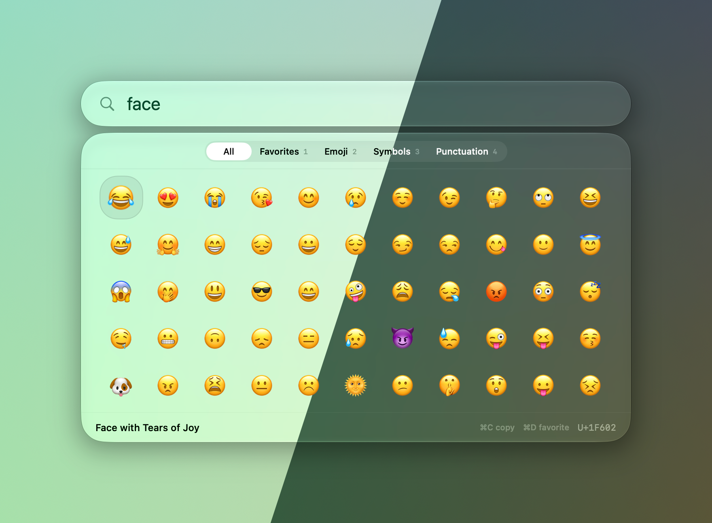

  

<h1 align="center">Agimat</h1>

  A palette for emoji and symbols on macOS. 
  <a href="https://bez.dev/apps/agimat/"><b>Download</b></a> · <a href="https://bez.dev/apps/agimat/releases/">Release notes</a> · <a href="https://bez.dev/apps/agimat/privacy/">Privacy</a>

  

Agimat is a free macOS app for finding and typing emoji and symbols. Open it with a keyboard shortcut, search, and press Return to insert the character at your cursor. It requires macOS 26 or later.

See what it does and download it at [bez.dev/apps/agimat](https://bez.dev/apps/agimat/). What changed in each version is in the [release notes](https://bez.dev/apps/agimat/releases/).

Questions or problems: [open an issue](https://github.com/bezhermoso/Agimat.app/issues) or email [apps@bez.dev](mailto:apps@bez.dev).
